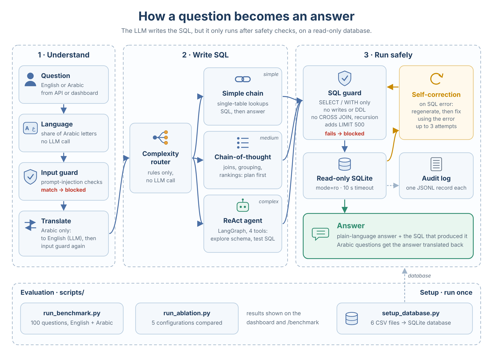

<div align="center">

# Text-to-SQL Chatbot

Ask questions about business data in **English or Arabic** and get answers backed by SQL that runs safely, read-only.

[](https://github.com/pradeepanpp/text-to-sql-chatbot/actions/workflows/ci.yml)
[](https://www.python.org/)
[](https://www.langchain.com/)
[](https://fastapi.tiangolo.com/)

</div>


**Problem.** Business users need answers from their data but don't write SQL. Dashboards only answer pre-built questions, and ad-hoc requests wait in an analyst's queue. Letting an LLM write SQL raises two risks: wrong answers, and a model that can be tricked into changing or exposing data.

**Solution.** A bilingual natural-language-to-SQL assistant. Each question is routed by complexity to one of three SQL generation strategies. Every query passes a safety layer, runs on a read-only connection and is written to an audit log. The answer is returned in the user's language together with the SQL behind it.

**Results** on a 100-question English/Arabic benchmark (GPT-4o-mini):

- **80% execution accuracy** (95% CI 71–87%): 90% simple, 94% medium, 44% complex questions
- **Five-way ablation:** chain-of-thought alone matches the full multi-strategy system (82% vs 80%); the router's benefit is lower latency
- **Safety by design:** SELECT-only policy, read-only database, query timeout, row limit, prompt-injection checks, full audit trail

**Stack:** Python · LangChain · LangGraph · GPT-4o-mini · SQLite · FastAPI · Streamlit · Docker · pytest · GitHub Actions

<p align="center">
  
  
</p>

---

## Results

| Metric | Value |
|---|---|
| Execution accuracy (strict) | **80%** (95% CI 71–87%) |
| Execution accuracy (lenient, extra columns allowed) | 84% |
| Simple / Medium / Complex | 90% / 94% / 44% |
| English (n=85) / Arabic (n=15) | 79% / 87% (overlapping confidence intervals) |
| Latency p50 / p95 | 3.2s / 8.1s |

**How accuracy is measured:** the generated SQL and a reference SQL are both executed, and their **results** are compared (row and column order ignored, numbers rounded to 2 decimals). Rate-limit and API errors are counted separately, not as model mistakes.

### Ablation

| Configuration | Accuracy (95% CI) | Complex | p50 latency |
|---|---|---|---|
| Simple chain only | 72% (63–80%) | 32% | 2.3s |
| **Chain-of-thought only** | **82% (73–88%)** | **48%** | 3.8s |
| ReAct agent only | 77% (68–84%) | 40% | 4.3s |
| Router | 79% (70–86%) | 40% | 3.1s |
| Router + self-correction (final system) | 80% (71–87%) | 44% | 3.2s |

Chain-of-thought for every question is as accurate as the routed system; routing reduces latency. Complex multi-table questions are the main weakness for every configuration.

---

## Architecture

<p align="center">
  
</p>

| Strategy | Used for | LLM calls |
|---|---|---|
| Simple chain | Single-table lookups | 2 |
| Chain-of-thought | Joins, grouping, rankings | 2 |
| ReAct agent | Comparisons, percentages, 3+ tables | 1 per step, capped at 24 steps |

**Safety layers:** prompt-injection checks (English and Arabic, also applied to the translation) · single `SELECT`/`WITH` statement only · write and DDL keywords blocked · CROSS JOIN and recursive queries blocked · `LIMIT 500` on every query · read-only database connection · 10-second timeout · one audit record per execution.

---

## Getting started

**Prerequisites:** Python 3.10+, an OpenAI API key, and the six CSV files in `data/csv/`.

```bash
git clone https://github.com/pradeepanpp/text-to-sql-chatbot.git
cd text-to-sql-chatbot
python -m venv .venv && source .venv/bin/activate   # Windows: .venv\Scripts\activate
pip install -r requirements.txt

cp .env.example .env                  # add your OPENAI_API_KEY
python scripts/setup_database.py      # build the SQLite database from the CSVs

uvicorn src.text_to_sql.api.main:app --port 8000          # API → http://localhost:8000/docs
streamlit run src/text_to_sql/dashboard/app.py            # Dashboard → http://localhost:8501
```

**Docker:** `python scripts/setup_database.py` then `docker compose up --build`

**Tests and evaluation**

```bash
pytest -q                          # offline tests (live tests run only with an API key and data)
ruff check .                       # lint
python scripts/run_benchmark.py    # 100-question benchmark
python scripts/run_ablation.py     # five-configuration ablation
```

CI runs lint, the offline test suite and both Docker builds on every push.

---

## API

| Method | Path | Purpose |
|---|---|---|
| POST | `/query` | Ask one question (English or Arabic) |
| POST | `/query/batch` | Up to 20 questions |
| GET | `/schema` | Tables, columns, row counts |
| GET | `/health` | Component status (503 when degraded) |
| GET | `/audit/stats` | Audit log summary |
| GET | `/benchmark` | Latest benchmark results |

---

## Project structure

```
src/text_to_sql/
├── chain/         pipeline orchestrator, router, simple / chain-of-thought / agent strategies
├── safety/        SQL guard and audit log
├── database/      CSV loader, schema context, read-only executor
├── language/      Arabic / English detection
├── evaluation/    benchmark dataset, runner, metrics
├── api/           FastAPI app
└── dashboard/     Streamlit UI
scripts/           database setup, benchmark, ablation
tests/             offline and live test suites
```

---

## Limitations and next steps

**Limitations**
- Complex multi-table questions reach 44% accuracy, and the ReAct agent is the least accurate strategy.
- The `regions` table stores cities; questions about sales regions are often misread.
- The benchmark was written for this schema and not held out from development, so scores are optimistic.
- The table allow-list is regex-based and can be bypassed (the read-only connection still prevents data changes).
- No authentication, rate limiting or conversation memory; this is a single-user demo.

**Next steps**
1. Use chain-of-thought for complex questions, with the agent only as a fallback when SQL fails.
2. Clarify the region / city distinction in the schema description.
3. Evaluate on a new held-out question set, balanced between English and Arabic.